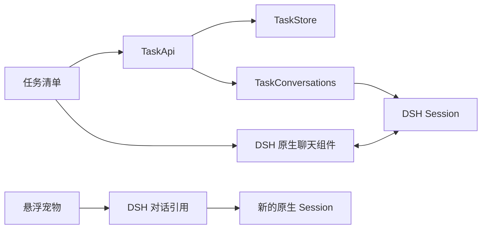

# 最小框架

悬浮宠物复用 DSH 原生能力完成历史复盘，已有任务清单与人工完成继续保留。

宠物注册在 `shell.overlay`，选择列表读取 Session 目录。点击开始后创建新的 Session，按选中 ID 从原生引用服务取得 mention，发送一条明确的复盘请求，再打开原生聊天。所选历史由 DSH 在处理消息时捕获并记入 Session；插件不另存复盘数据库。一次最多引用三个对话，压缩、截断和来源信息沿用原生引用规则。发送结果不明时，只能用相同 Session 和请求身份确认，不能偷偷创建另一份复盘。

外观保存在当前浏览器的 `team-dsh:pet-appearance:v1` 中，与 Host 任务和 Session 数据独立。内置鲸鱼娘编入 Client，不请求远端图片。自定义图片先检查大小、格式及解码结果，再保存；保存失败保留原选择。图片不加入复盘消息。

用户创建任务时，Host 保存名称与创建请求身份。重复提交同一请求返回原任务。完成框只改变任务状态，不停止或启动对话。

点击任务时，Host 查找已有 Session 关联。没有关联则先保存一个固定 ID，再创建空 Session；已有关联则核对持久记录，不能因为找不到会话就悄悄换一个。页面持有原生 Session 引用，切换任务或卸载时释放。消息、模型配置、权限和轨迹全部由 DSH 管理。

页面与 Host 只有四种操作：`list`、`create`、`set-done`、`open`。Host 检查 owner 身份与输入，任务写入串行处理，插件关闭时等待已接纳操作结束。

## 数据保留

继续使用 `team_dsh_tasks` 存储域。任务中不再使用的旧字段原样保存；同文件的 `executions`、`reviews` 两表仅保留 JSON 数据，不提供业务接口。DSH JSON 后端会重写整个文件，删除表定义会丢掉这些数据，因此保留这两个表名。

旧成果、成果评审、M1 存储域和 Session 日志不打开或删除。最小版不再把旧目标和验收条件自动注入消息。名称与完成状态只是清单内容，用户在原生输入框提交实际工作要求。

增加功能前先确认使用路径，再决定是否需要新的文件或依赖。
