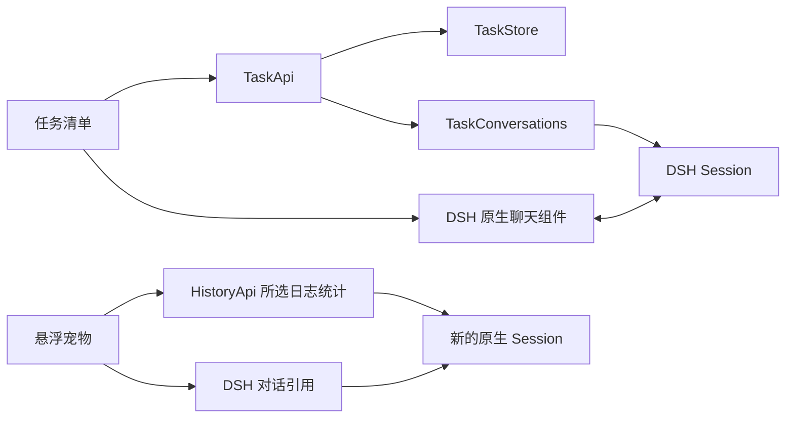

# 最小框架

悬浮宠物复用 DSH 原生能力完成历史复盘，已有任务清单与人工完成继续保留。

宠物注册在 `shell.overlay`，选择列表读取 Session 目录。点击开始后创建新的 Session，按选中 ID 从原生引用服务取得 mention，发送一条明确的复盘请求，再打开原生聊天。所选历史由 DSH 在处理消息时捕获并记入 Session；插件不另存复盘数据库。一次最多引用三个对话，压缩、截断和来源信息沿用原生引用规则。发送结果不明时，只能用相同 Session 和请求身份确认，不能偷偷创建另一份复盘。

外观保存在当前浏览器的 `team-dsh:pet-appearance:v1` 中，与 Host 任务和 Session 数据独立。内置鲸鱼娘编入 Client，不请求远端图片。自定义图片先检查大小、格式及解码结果，再保存；保存失败保留原选择。图片不加入复盘消息。

用户创建任务时，Host 保存名称与创建请求身份。重复提交同一请求返回原任务。完成框只改变任务状态，不停止或启动对话。

点击任务时，Host 查找已有 Session 关联。没有关联则先保存一个固定 ID，再创建空 Session；已有关联则核对持久记录，不能因为找不到会话就悄悄换一个。页面持有原生 Session 引用，切换任务或卸载时释放。消息、模型配置、权限和轨迹全部由 DSH 管理。

任务页面与 Host 有四种操作：`list`、`create`、`set-done`、`open`。Host 检查 owner 身份与输入，任务写入串行处理，插件关闭时等待已接纳操作结束。

## 工具与用量复盘

开始复盘后，Client 把已勾选的 1—3 个 Session ID 交给 owner-only `HistoryApi.analyze`；选择列表仍只读取目录。接口验证身份、数量与去重，不搜索其他来源，也不调用受 cwd 授权限制的 `tool-session-query`。Host 在 `sessionQuery` 和 `sessionPersistence` 的注入作用域内注册接口，关闭时取消并等待所有读取释放观察租约及文件句柄。

运行中的来源使用 `sessionQuery.observeSession` 固定日志截止点。离线观察会为中断尾部补出内存恢复事件，因此离线统计通过原生持久化只读句柄重新读取完整、已验证的原始前缀，使用该次读取的最后序号作为截止点；不把补出的事件写回日志。已持久化的 `TOOL_OUTCOME_UNKNOWN`、`TOOL_NOT_STARTED` 恢复结果单列，不视为工具完成、失败或耗时样本。读取任一来源失败时不返回部分报告，也不提交复盘消息。

工具按同一轮次、步骤内的 callId 匹配 `tool/call` 与追加的 `tool/result`，不把压缩替换当成新结果。显式错误只来自真实结果的 `isError`；缺失结果保留未结束。耗时为两事件时间戳的非负差，并发调用可能重叠，时钟倒退保留未知。每项明细附调用、结果或恢复序号。

用量复用 token-meter 的原始 usage 选择规则：优先 `assistant/message.usage`，否则取消息或尝试内嵌流的最后一个 usage 样本；同一步的重复结算替换前值，`llm/retry-started` 开始新的计数项。直接读取原始样本是为了保留可选字段的缺失，不能使用已补零的 token-meter 汇总。每个字段分别给出已知合计、已报告次数与缺失次数；不估算总 token、价格或缓存命中率，不把推理 token 再加到输出。未结算的请求不算已报告样本。

测量数据按来源写入原生复盘消息；不跨来源相加，避免分支继承日志被重复计入总量。每个来源最多携带前 100 条调用和 100 条用量明细，汇总仍遍历全部事件，报告写明省略行数、继承事件数及统计截止点。原生文字引用在处理消息时另行捕获，可能包含较新的事件。宠物列表的“查看对话”直接调用原生导航，打开来源后可切到“轨迹”核对序号；只打开来源不会发送消息或发起统计。测量字段里的名称和 ID 转义为普通文本，不能引入额外 Session 引用。发送结果不明时，重试沿用原消息、统计和请求身份；模型提示要求区分测量事实与原因推测，不自动搜索市场、安装工具或改变权限。

`highlights` 从捕获的完整日志选取四类证据，每类最多五条：最早的显式错误、最早的未结束调用、调用到结果间隔最长的记录、供应商报告总 token 最高的样本。排序并列时保留日志顺序；缺失耗时或总 token 不参与相应排序，零是有效测量值。重点事件独立于前 100 条明细，且不增加汇总计数。相同事件可能同时出现在错误和耗时等类别，消息说明不能重复计数。所有展示使用同一组转义规则。没有重点事件时不输出空栏目。

复盘以工作结果、有效做法、受阻点和下一步组织。结果区分用户确认、助手自述和尚未验证；定性判断附来源和短引文，工具及用量判断附事件序号。跨对话模式至少需要两个来源中的独立片段，继承记录不能重复充当证据。改进建议须依据实际用户纠正、显式失败或反复受阻，且保留用户明确约束；最多三条，每条给出依据、适用情形、具体行动和下次验证方法，较长复盘必要时附一段供用户采纳的提示词或项目约定草案。只有一轮短对话时要求中文正文最多 300 字或英文 180 词、最多四点及一条建议，不复制完整测量表；依据不足时不补空栏目。提示明确工具参数和结果正文是摘录主动排除的内容，不能据此诊断原始日志缺失、归责用户指令或提出工作流修改。不推算生产率、节省幅度或个人习惯。Client 将完整指令与测量值一起发送并由原生 Session 记入日志；模型解释没有确定性正确保证，任务完成仍由人工操作。

## 数据保留

继续使用 `team_dsh_tasks` 存储域。任务中不再使用的旧字段原样保存；同文件的 `executions`、`reviews` 两表仅保留 JSON 数据，不提供业务接口。DSH JSON 后端会重写整个文件，删除表定义会丢掉这些数据，因此保留这两个表名。

旧成果、成果评审、M1 存储域和 Session 日志不打开或删除。最小版不再把旧目标和验收条件自动注入消息。名称与完成状态只是清单内容，用户在原生输入框提交实际工作要求。

增加功能前先确认使用路径，再决定是否需要新的文件或依赖。
